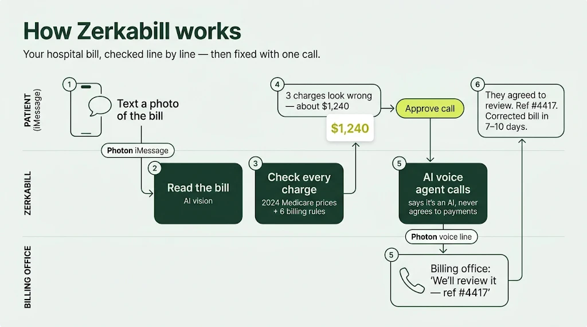
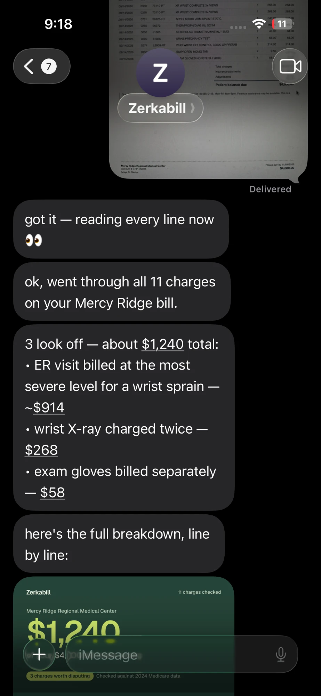
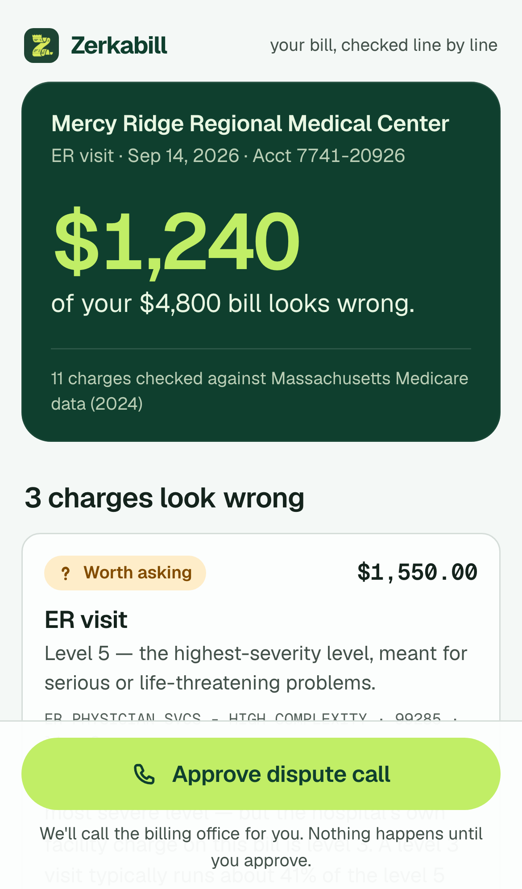
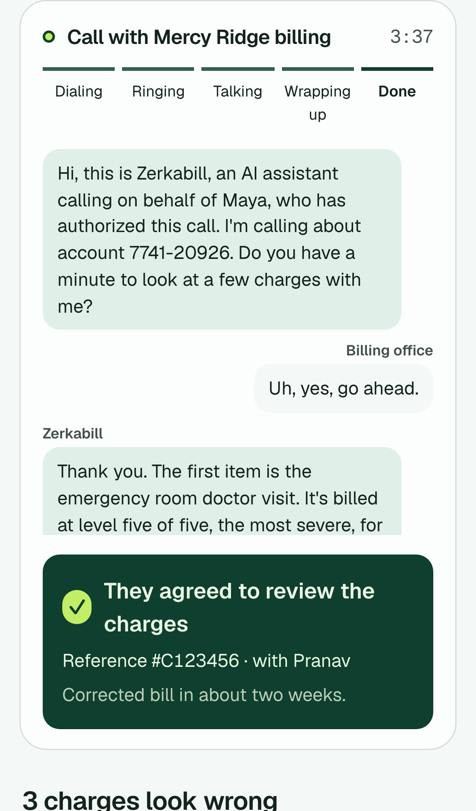
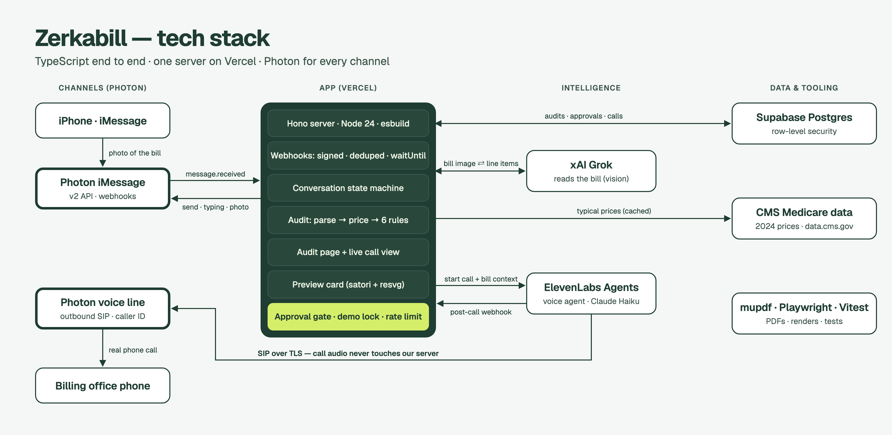

# Zerkabill

**A patient advocate in iMessage.** Text it a photo of your hospital bill. It finds the charges that look wrong, shows you why with real Medicare price data, and — only with your OK — calls the billing office to get them taken off, then texts you what they said.

Built at HackHarvard 2026 on **Photon** (iMessage + voice line), **ElevenLabs Agents** (the phone call), **xAI Grok** (reading the bill), **Supabase**, and **Vercel**.

> Live: **https://zerkabill.vercel.app** · iMessage line: **+1 (628) 998-8199** · Calls come from **+1 (413) 341-5654**
> (Photon shared iMessage lines only accept registered senders, so texting works from the demo phone.)

---

<p align="center"></p>

> **Judges — 60-second tour**
> - **Where Photon is used:** iMessage in and out, a Photon voice line that places the real call, call events → [Where Photon is used](#where-photon-is-used)
> - **Does it work?** 100% of planted errors caught, 0 false flags, 81/81 lines read correctly from phone photos → [Evals](#evals)
> - **Is it safe?** Nothing is dialed without approval; demo mode can only call one number; the agent says it's an AI and never agrees to payments → [Safety and trust](#safety-and-trust)
> - **The demo:** [docs/DEMO.md](docs/DEMO.md)

## See it

<table>
  <tr>
    <td width="33%" valign="top"><br><sub><b>Text a photo.</b> A summary and a preview card come back in about 20 seconds.</sub></td>
    <td width="33%" valign="top"><br><sub><b>The audit.</b> Every line checked against 2024 Medicare data, with the reason for each flag.</sub></td>
    <td width="33%" valign="top"><br><sub><b>The call.</b> A real call from our Photon number — it says it's an AI first, and comes back with a reference number.</sub></td>
  </tr>
</table>

## The problem

Hospital bills are written in billing codes most people can't read. Uninsured patients are often charged full list price, and duplicate charges, inflated ER visit levels, and supplies billed one by one are common. Most people pay rather than spend hours on hold disputing them.

**Maya, 24, uninsured**, went to the ER for a sprained wrist and an X-ray. Her bill: **$4,800**. Zerkabill finds **$1,240** that looks wrong — a level-5 ER visit for a sprain, the same X-ray billed twice, and a box of exam gloves — and calls the billing office for her.

## How it works

<p align="center"><br><sub>Drawn from the code (<code>scripts/stack-diagram.ts</code>), so every arrow is a real call path.</sub></p>

1. **Text a photo.** The agent asks at most two quick questions (hospital, insurance), skipping anything you already said, and shows a typing indicator while it reads.
2. **Audit.** The bill is transcribed line by line (code, quantity, amount, date). Every coded service is compared with what providers in that state typically submit to Medicare for the same code (**CMS 2024 data**, cited on every figure). Six deterministic rules flag problems; **the LLM never decides whether a charge is wrong.**
3. **Results in ~20 seconds.** A short summary in iMessage, plus a link that renders as a preview card. The page shows every line with a *Likely error / Worth asking / Looks fair* badge, a plain-English meaning, the reason, and the evidence.
4. **Approve the call.** The approval restates exactly who will be called and what will be asked. Nothing is dialed without an approval record.
5. **The call.** An ElevenLabs agent dials from our Photon number, says in its first sentence that it is an AI calling on the patient's behalf, goes through every disputed charge, never agrees to payments or settlements, and asks for a reference number. You can watch it live on the audit page.
6. **The outcome, by text.** Rep name, reference number, next step — or, if they need the patient, a 3-way-call option and a word-for-word script.

## Where Photon is used

| | What we use | Code |
|---|---|---|
| **iMessage in** | Photon v2 **webhook destination** for `message.received` (Standard Webhooks HMAC, verified; deliveries deduped by message id; work runs in Vercel `waitUntil` after a fast 200) | `src/photon/webhook.ts`, `src/photon/verify.ts` |
| **iMessage out** | `sendMessage` (text), `setSpaceTyping` (typing indicator while auditing), `downloadAttachment` (the bill photo) on a **shared iMessage line** | `src/photon/client.ts` |
| **Proactive messages** | Texts sent outside an inbound webhook (call started, call outcome) via the stored space + agent user | `src/agent/call-flow.ts`, `src/voice/finish.ts` |
| **Voice line** | A Photon **voice number** (`voip_line`) with a voice profile **outbound SIP credential** (`sip.photon.codes`, TLS 5061, SHA-256 digest) | `scripts/setup-voice.ts` |
| **The call** | That number is imported into ElevenLabs as an **outbound SIP trunk**, so the billing office sees our Photon number as caller ID | `src/voice/start-call.ts` |
| **Call events** | Subscribed to Photon `call.*` webhook events (`started`, `ringing`, `answered`, `ended`) — received, verified, and logged; the live call view currently reads progress and transcript from ElevenLabs | `src/photon/webhook.ts` |
| **Rich card** | Photon v2 has no mini-app content type yet (confirmed with Photon staff), so the audit link is sent as text and iMessage renders it as a preview card with a per-audit image (`/audit/:id/og.png`) | `src/web/og.ts` |

## Evals

`npm run eval` — 40 seeded synthetic bills (10 clean, 71 planted errors across all 6 rules), priced from the cached CMS rows, with deliberate **hard negatives**: level-5 visits for serious diagnoses, repeat imaging with modifier 76, the same lab on different days, prices just under the 3× threshold, and billable supplies.

`npm run eval -- --photo` — additionally renders 10 bills (3 clean, 7 with errors) as **phone photos** (perspective tilt, uneven light, JPEG) and runs them through the full pipeline: vision parse → rules.

| Metric | Rules (40 bills) | Phone photos → parse → rules (10 bills) | Target |
|---|---|---|---|
| Error catch rate | **100%** (71/71) | **100%** | ≥ 85% |
| Flag precision | **100%** | **100%** | ≥ 90% |
| Clean bills with any flag | **0 / 10** | **0 / 3** | ≤ 10% |
| Parse accuracy (code + amount) | — | **81 / 81 lines** | ≥ 95% |

**Read this honestly:** the same team wrote the generator and the rules, so the rule-only column is a consistency check. The photo column is the meaningful one — it tests the part that can actually fail, the vision model reading a bill. Steeply tilted photos are harder (rows can misalign); when two reads disagree, Zerkabill asks for a retake instead of guessing.

## The six rules

| Rule | Detects | Severity |
|---|---|---|
| Duplicate | Same code, same day, same amount, no repeat-procedure modifier | Likely error |
| Routine supply | Gloves, gowns, IV start kits… billed one by one | Worth asking |
| Price outlier | More than 3× the typical state charge for that code (CMS 2024) | Worth asking |
| Visit level | ER level 4–5 for a minor diagnosis, or above the hospital's own facility level | Worth asking |
| Date outside stay | Service dated before admission or after discharge | Likely error |
| Math check | Line items don't add up to the bill's total | Likely error |

Each finding carries its evidence (benchmark and data year, rule, the duplicate's line number). Supplies, DME, and facility fees are never price-benchmarked against physician data.

## Safety and trust

- **No call without approval.** Every call needs an approval record that restates who will be called and what will be asked; approvals are claimed atomically so a double tap can't dial twice.
- **Demo lock.** With `DEMO_MODE=true` the only number the system will ever dial is `DEMO_BILLING_OFFICE_NUMBER`. No calls to real hospitals.
- **Rate limit.** One call per conversation per 5 minutes.
- **Disclosure.** The agent's first sentence says it is an AI assistant calling on the patient's behalf, with their authorization.
- **Never binding.** The agent never agrees to payment plans, settlements, or amounts: "I'll pass that along to Maya."
- **Hedged language.** "Looks like", "worth asking about" — never fraud or illegal. A banned-word filter guards agent-written texts.
- **Privacy.** Bill images are never stored. Date of birth, address, and insurance member ID are never extracted. Audit links are unguessable and `noindex`; there is no listing endpoint. All tables have row-level security with server-only access.
- **Your rights** notes (financial assistance at nonprofit hospitals, No Surprises Act, good-faith-estimate disputes) are shown only when they apply, hedged, and linked to the official IRS/CMS page they were checked against.
- `tests/call.test.ts` proves that missing approvals, non-demo numbers, and rate limits never reach the ElevenLabs API.

*Zerkabill is not legal or medical advice.*

## What we learned about Photon v2 (beta)

- Webhook destinations sign with **Standard Webhooks** (`whsec_` secret, `webhook-id` / `-timestamp` / `-signature`).
- **Shared iMessage lines reject threaded replies** (`parentMessageId`) — every send is a plain message.
- **Shared lines silently drop PDF attachments**; images work. (The PDF path is built — rasterized with mupdf — for when files are supported.)
- **No mini-app content type** in v2 yet → link preview card.
- ElevenLabs' outbound-call API returns only once the callee answers; we allow 75 s and match the post-call webhook by our own call id.

## Running it

```bash
npm install
cp .env.example .env          # fill in Photon, Supabase, xAI, ElevenLabs keys
supabase db push              # schema in supabase/migrations
npx tsx scripts/setup-voice.ts  # creates the ElevenLabs agent, imports the Photon SIP number, registers the post-call webhook
npm run dev                   # local server on :8787
npm test                      # 61 tests
npm run audit data/demo_bills/maya_er.pdf   # offline audit of the demo bill
npm run eval -- --photo       # evals
```

Deploy: `vercel deploy --prod` (the build bundles `src/` with esbuild; see `scripts/build.mjs`).

## Repo map

```
src/
  server.ts            Hono routes
  photon/              webhook verify + parse, send/typing/download client
  agent/               conversation state machine, copy, intake, approval gate, call flow
  audit/               parse (vision), rasterize (PDF), media (HEIC), benchmark (CMS), rules, decode, explain, rights, pipeline
  voice/               agent prompt, start-call (guards), live call state, post-call webhook + outcome texts
  web/                 audit page, landing page, OG preview image
data/                  CMS seed prices (2024, MA), plain-English code table, demo bill, fonts
evals/                 synthetic bill generator, eval runner, report.json
scripts/               setup-voice, render-bill, photo-sim, parse-check, load-webhook, seed-prices
tests/                 rules, parsing, webhook, call guards, copy, rights
```
